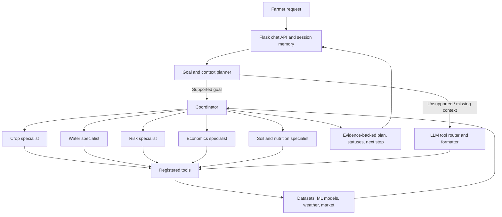

# Project Portfolio Report

## Autonomous Precision Agriculture Decision Support System

**Course:** 25AI2014 – Agentic AI  
**Programme:** B.Tech CSE-AIML, Semester VII  
**Academic year:** 2026–2027  
**Prototype:** AgriDecision  
**Domain:** Tamil Nadu crop planning and farm decision support

## Abstract

AgriDecision accepts a farmer's goal and available farm context, builds a bounded action plan, allocates evidence gathering to agricultural specialist agents, and presents a traceable result. It combines a Flask application, LLM routing and language generation, tool adapters, historical datasets, trained crop-risk and yield models, session memory, weather, market data, and soil-image classification. A specialist plan is preferred for supported goals; the LLM router handles requests outside the deterministic plan library. The system is a prototype and its outputs are decision support, not guaranteed outcomes.

## Problem and objectives

Farm decisions depend on interacting conditions such as crop, district, soil, rainfall, pest pressure, input cost, and season. A single lookup may omit relevant constraints. This project aims to:

1. Convert a natural-language farming request into an explicit goal and structured context.
2. Select a small plan matched to that goal and avoid unnecessary tool calls.
3. Delegate checks to domain specialists and coordinate their outputs.
4. Preserve farm context across follow-up questions.
5. Show evidence sources, execution status, and uncertainty to support review.
6. Provide a repeatable method to evaluate task completion, robustness, and efficiency.

## System architecture

The current team is a coordinated set of named specialist workers implemented as tool-backed functions and controlled by a deterministic planner. The specialists do not run independent LLM loops or negotiate. This keeps decisions auditable and bounded while providing a concrete multi-agent orchestration prototype. `/chat` returns the `plan` and `agents_used` fields; `/chat_stream` includes them in its final `done` event.

## Planning formalism

The planner represents a request as a goal `G`, context state `S`, ordered actions `A`, observations `O`, and terminal response `R`:

`(G, S) → A1, A2, …, An → O1, O2, …, On → R`

`S` contains district, crop, soil, and season resolved from the current message and session memory. `GOAL_PLANS` maps supported goals to specialist/tool actions. Before execution, the planner checks required context. Each tool response becomes an observation with a completion status. Failed tools are retained in the trace, successful outputs are synthesized, and a recommendation is withheld when there is no usable evidence. Plans are bounded by the fixed plan definition, so an LLM cannot invent executable tools or run an open-ended loop.

Example: “Pest risk for rice in Thanjavur” resolves `G = pest_assessment` and the crop/district state, assigns the risk specialist to `predict_pest_risk_ml`, records its status, and returns the model result with the tool name.

## Agent roles and tools

| Specialist | Responsibilities | Example tools |
| --- | --- | --- |
| Crop advisor | District crop profile, shortlist, and suitability | `get_district_overview`, `get_top_crops`, `compute_suitability_score` |
| Water advisor | Rainfall and irrigation evidence | `get_rainfall_stats`, `get_irrigation_profile` |
| Risk advisor | Crop pest assessment and historical pest context | `predict_pest_risk_ml`, `get_pest_risk_historical` |
| Yield advisor | Yield estimate from trained model | `predict_crop_yield_ml` |
| Soil and nutrition advisor | Fertilizer guidance using crop and soil context | `get_fertilizer_recommendation` |
| Economics advisor | Cultivation cost and estimated crop profit | `estimate_crop_cost`, `estimate_crop_profit` |

The shared context, plan trace, and tool result are the coordination interface. For broad crop choice, the planner can request a shortlist plus rainfall and historical pest evidence; for a specified crop, it can request suitability, rainfall, and profit evidence.

## Implementation

- **Application:** Flask routes for browser UI, regular and streamed chat, session context, weather, market prices, image upload, and scenario simulation.
- **Agent workflow:** deterministic plan selection for common goals plus an LLM router and prose model for broader requests.
- **Tools:** adapters in `tools.py` expose a registry; specialists invoke only registered functions.
- **Memory:** the server stores district, crop, soil, season, and month per session; client context can also be set explicitly.
- **Data and ML:** `data_engine.py` reads local Tamil Nadu agricultural datasets; sklearn pipelines classify pest risk and estimate yield; the soil model classifies uploaded images.
- **Interface:** browser dashboard uses AgriDecision branding and displays the plan and evidence in the conversation.

## Evaluation plan and metrics

Evaluate with a fixed case set containing at least five examples per supported goal, plus missing district/crop, unknown district, malformed input, and unavailable model/API cases. Keep the dataset and model version fixed for each run. For latency, repeat each case five times and report median and 95th percentile.

| Metric | Definition |
| --- | --- |
| Goal accuracy | Correct goal classification divided by labeled requests |
| Task completion | Requests returning all required evidence divided by supported requests |
| Tool success rate | Successful tool calls divided by attempted tool calls |
| Plan efficiency | Executed calls divided by calls prescribed by the plan specification |
| Latency | End-to-end median and 95th percentile, reported separately for planned and LLM-routed cases |
| Robustness | Completion rate under missing context, invalid entities, unavailable services, and malformed tool data |
| Pest model quality | Held-out per-class precision, recall, F1, and confusion matrix against labeled outcomes |
| Recommendation quality | Instructor/agronomist scoring for evidence relevance, clarity, and uncertainty handling |

**Current smoke-check evidence:** the pest-risk request for rice in Thanjavur returned a completed risk-specialist trace and a model output (`High Risk`) in the local environment. Crop shortlist and profit requests also returned plans. This is a functionality check, not a model-accuracy result. No held-out accuracy or latency benchmark is claimed; those values must be measured with the protocol above.

## Failure modes, ethics, and limitations

- Missing context may require a follow-up or LLM fallback. Unsupported free-form goals do not automatically receive a specialist plan.
- A failed tool is visible in the execution status; if all tools fail, the system does not produce an evidence-backed recommendation.
- Pest and yield model quality depends on its training labels and data coverage. Local runtime produced a sklearn version warning before dependency alignment; reinstall using the pinned 1.7.0 requirement and validate the model before evaluation.
- Rainfall history, estimated profit, and suitability are not necessarily live or complete for every farm. Market and weather services can be unavailable.
- No pesticide dosage or guaranteed yield is prescribed. Farmers should use field observation and local extension advice for high-impact decisions.
- Session memory is conversational context and should not be treated as a verified farm record.

## Rubric and course outcome mapping

| Assessment dimension | Evidence in project |
| --- | --- |
| Agent planning and goal formulation | Explicit goal set, context resolution, preconditions, bounded action plans |
| Agent architecture and integration | LLMs, tool registry, ML/data services, weather/market connectors, and session memory |
| Multi-agent orchestration | Coordinator dispatches to named specialists, aggregates observations, and exposes statuses |
| Implementation and functionality | Flask UI/API, streamed chat, specialist tools, crop data, models, and image workflow |
| Testing and performance evaluation | Metric definitions and repeatable benchmark protocol; measured benchmarks remain to be run |
| Innovation | Combines crop, water, risk, and economics evidence as a coordinated farm decision workflow |
| Presentation and viva | Architecture, planning example, role table, and limitations support a live demonstration |
| Report preparation | This report records objectives, design, implementation, evaluation, risks, and rubric mapping |

## Demonstration script

1. Open AgriDecision and explain the active farm context panel.
2. Ask “Pest risk for rice in Thanjavur” and point out the goal, risk specialist, model tool, result, and execution status.
3. Ask “Best crops for Madurai with red soil during Kharif” and show the coordinated crop, water, and risk plan.
4. Ask a follow-up question using the remembered district/crop and show how session context carries forward.
5. Explain the difference between a model-backed output and historical or assumption-based estimates; show the evaluation metrics and limitations.

## Conclusion

AgriDecision converts the previous general agricultural assistant into a goal-directed, inspectable decision support prototype with explicit planning, coordinated specialist workers, tools, memory, and an evaluation framework. Further work should add held-out model evaluation, broader farm-specific constraints, structured persistent evaluation logs, and richer independent agent collaboration.
